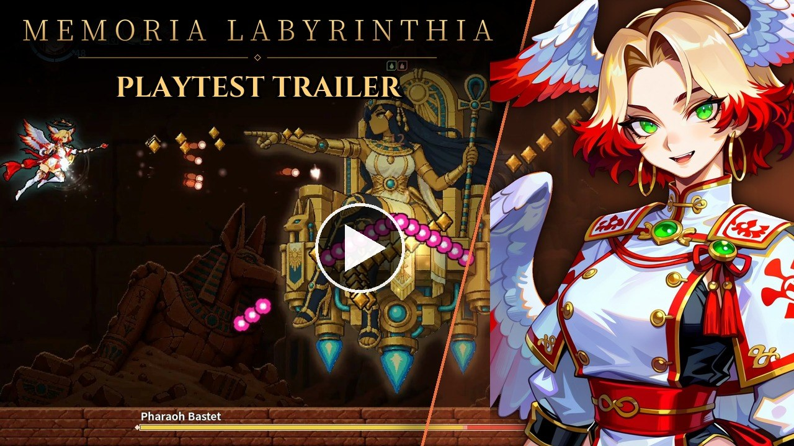
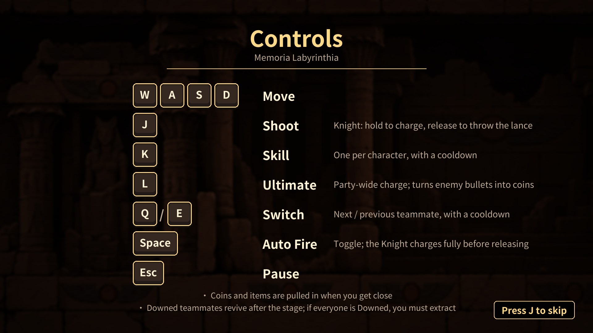

# Memoria Labyrinthia

[繁體中文](README.md) · v0.1.0 (20261014) · Prototype release

Memoria Labyrinthia is a side-scrolling shooter prototype. Switch between a mage, knight and dryad, managing their individual Lucidity gauges against combat damage and time drain as you explore Overgrown Ruins and Sunken Temple.

▶ Playtest trailer: [English](https://www.youtube.com/watch?v=C7s5uIIwHOk) / [繁體中文](https://www.youtube.com/watch?v=eDEu2AUrbzY)

## About this project

Memoria Labyrinthia is a passion project. The latest release build, v0.1.0, is the prototype: it focuses on testing the core gameplay and performance, and the concepts and visual presentation are very likely to change in later builds.

## Prototype status

Content, names and balance may change. At the Shrine, the options marked WIP (Change Runes, Choose a Boon, Return to Guild) are not implemented yet; choose Ready to Depart to continue. The dryad joins through the existing cleansing/unlock rules, or through the optional starting-lineup assist.

## Download and launch

There are two downloads with identical contents; pick either:

- **Archive (recommended)**: `MemoriaLabyrinthia-v0.1.0-20261014-win64-en.zip`. Extract it anywhere and run `MemoriaLabyrinthia.exe`, keeping its `.pck` alongside it.
- **Installer**: `MemoriaLabyrinthia-v0.1.0-20261014-win64-en-setup.exe`. It lets you choose the install folder (default: your own `%LOCALAPPDATA%\Programs\Memoria Labyrinthia`, no administrator rights needed), can add a desktop shortcut, and can be removed from Windows "Add or remove programs". If the installer does not install or launch correctly, use the archive instead.

Settings and saves are stored in `%APPDATA%`; reinstalling, switching to the other language package or uninstalling never deletes them. Game data is packed inside the `.pck`; no other folder is needed or read.

If Windows SmartScreen blocks it, verify the download source and SHA-256 first. Once you have confirmed the file is from this project, use More info → Run anyway. The SHA-256 of the installer and of the archive is supplied beside each as a `.sha256` file; checksums for the included files are in `SHA256SUMS.txt`.

Checksum command: `Get-FileHash .\MemoriaLabyrinthia-v0.1.0-20261014-win64-en-setup.exe -Algorithm SHA256` or `Get-FileHash .\MemoriaLabyrinthia-v0.1.0-20261014-win64-en.zip -Algorithm SHA256`.

## Requirements

Windows 10/11 64-bit and a keyboard. Target minimum (not yet verified on that hardware): Intel Core i3 4th generation, 4 GB RAM, a GeForce GTX 1650 (4 GB) or Radeon RX 5500 XT class discrete GPU; integrated graphics are not supported. Controllers are not supported yet. Choose borderless fullscreen or 1280×720, 1600×900 and 1920×1080 windows; sizes that do not fit the display are hidden.

## Controls

WASD to move, J to attack, Q/E to switch, K for skill, L for ultimate, Space to toggle auto fire, Esc to pause. Use W/S, J and Esc in menus; A/D changes volume. Controls and the three-page tutorial can be reopened from the main menu.

A flashing-light warning appears on every launch. The game includes flashes and rapid flicker; read the complete warning in the game.

## Settings and assists

- Traditional Chinese and English switch immediately.
- Start at the first stage of either biome. Sunken Temple is designed for three agents.
- Third Member from Start changes the agent lineup without granting the persistent unlock.
- Invincible Mode prevents damage from hits, collisions and terrain; Lucidity still drains over time.
- Damage Numbers are off by default. Hits on the same enemy merge within a short time window.
- Results identify invincibility and three-member starting assists when enabled.

Preferences are stored at `%APPDATA%\Godot\app_userdata\Memoria Labyrinthia\settings.cfg`. An existing Prototype unlock is copied only when the new save is absent; the old file is kept.

## Feedback

Please fill in the playtest survey (no sign-in, no email collected):

- English: <https://forms.gle/Hovxnh7ur2qhL5QR6>
- 繁體中文: <https://forms.gle/WTVr1ddyM2k8AT2i9>

The all-agents-down extraction and final-clear results also show a "Give Feedback" button, which opens the survey in the language the game is showing at that moment.

The game ships as an English and a Traditional Chinese package that differ only in the language used on the first start. Both can switch language from the main menu and share the same settings and save, so if you played one package before, the other one starts in the language you chose last.

Include the version, reproduction steps, a screenshot and `%APPDATA%\Godot\app_userdata\Memoria Labyrinthia\logs\godot.log`. Paste the path into File Explorer to locate the log. Application flow/data diagnostics redact common user-directory names; you can still review the file before sharing it.

## AI-generated assets

Characters, enemies and backgrounds were made with OpenAI image-generation tools, then selected, approved and post-processed by people. Music was generated with Suno under a Pro subscription, downloaded through the official service and used under Suno's paid-plan terms. Anthropic Claude and OpenAI Codex assisted with code and design documents; the author reviews and makes the final decisions. Undisclosed underlying model versions are not inferred.

## Credits and licenses

Made by **SulHound** (© 2026, all rights reserved); published by **LabDoge**. Official source only: <https://github.com/labdoge/memoria-labyrinthia-release/releases>. Copies from anywhere else may be tampered with; do not run them.

The game is free to play but is not open source, and its assets may not be reused or modified. You may share gameplay videos, streams and screenshots and make non-commercial fan works, and sharing the official GitHub download link is welcome. Selling, redistributing outside the official source, unpacking assets, making mods (planned to open after the beta), impersonating the author and AI training are not permitted. Full terms: [LICENSE.md](LICENSE.md).

See [licenses](licenses/) for Godot MIT and engine third-party notices, Noto Sans TC OFL, .NET toolchain notices and asset sources. Sound effects use adapted clips from the Adobe Audition royalty-free sound-effects library, not a standalone sound-effects pack. Third-party content retains its respective terms.

The project uses a Godot .NET editor, but the game currently uses GDScript and has no C# game assemblies or separately bundled .NET runtime directory.

## Changelog

- v0.1.0 (20261014): First confirmed prototype release. Two biomes (Overgrown Ruins, Sunken Temple) of six stages each with a miniboss and boss, invasions, skills / switch effects / ultimates for all three characters, the new lighting and effects; game data packed in the PCK.
- 2026-10-06: Prepared the first public prototype with bilingual startup/tutorial screens, title and menus, persistent settings, player assists, damage numbers and a separate public-build profile.
