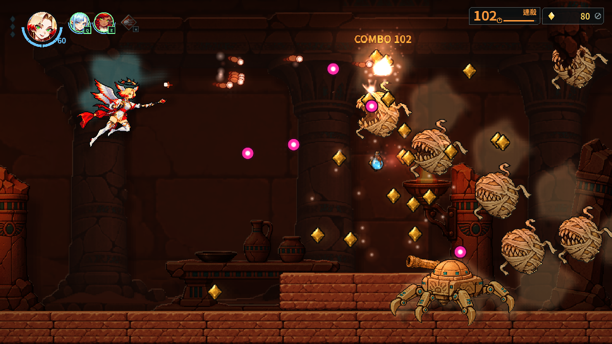
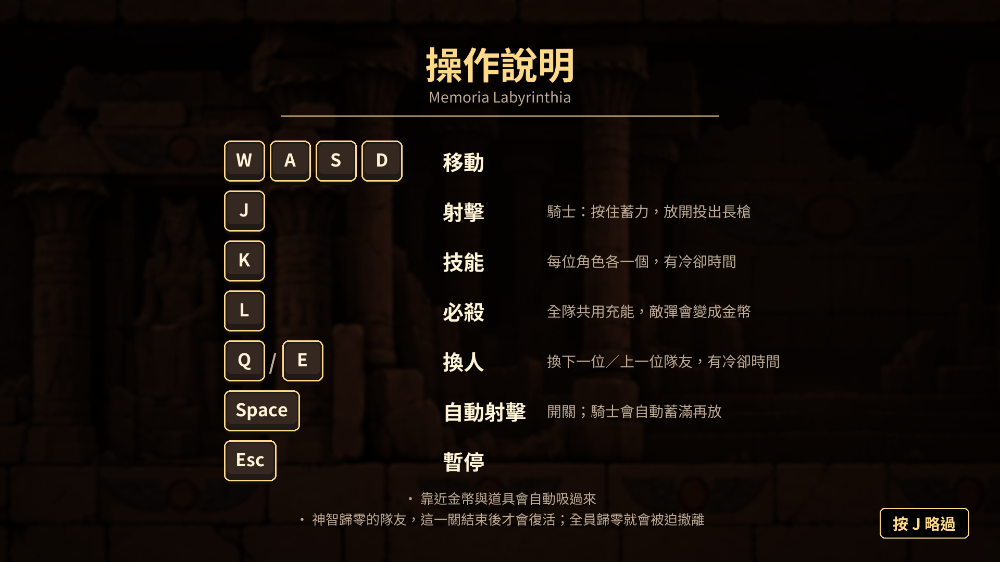

# Memoria Labyrinthia

[English](README.en.md) · v0.1.0（20261014）· 原型發佈版

Memoria Labyrinthia 是橫向捲軸射擊原型。輪換法師、騎士與樹精，以各自的神智量表承受戰鬥與時間消耗，探索草蔓廢墟及沙下神殿。

## 關於本專案

Memoria Labyrinthia 是一個熱情專案（passion project）。目前最新的發佈版本是 v0.1.0 原型版，目的在於測試核心玩法與效能；遊戲的概念與畫面呈現，在之後的版本中都很有可能改變。

## 原型狀態

內容、名稱與數值仍可能改動。神龕中標示 WIP 的「換符文」「增益三選一」「回公會」尚未實作；請選「整備完成，出發」繼續。樹精依正常淨化／解鎖規則加入，也能用選單輔助選項從頭加入。

## 下載與啟動

有兩種下載方式，內容完全相同，擇一即可：

- **安裝檔（推薦）**：`MemoriaLabyrinthia-v0.1.0-20261014-win64-zh-TW-setup.exe`。執行後依畫面選擇安裝位置（預設為個人資料夾 `%LOCALAPPDATA%\Programs\Memoria Labyrinthia`，不需要系統管理員權限），可建立桌面捷徑，並可從 Windows「新增或移除程式」解除安裝。
- **壓縮檔**：`MemoriaLabyrinthia-v0.1.0-20261014-win64-zh-TW.zip`。解壓縮到任意資料夾後執行 `MemoriaLabyrinthia.exe`，保留同目錄的 `.pck`。

設定與存檔存放在 `%APPDATA%`，重新安裝、換成另一個語言版本或解除安裝都不會刪除。遊戲資料封裝在 `.pck` 內，不需要也不會讀取其他資料夾。

若 Windows SmartScreen 攔截，先確認下載來源並核對 SHA-256；確認是本專案的檔案後，可用「其他資訊」→「仍要執行」。安裝檔與壓縮檔的 SHA-256 位於旁附同名 `.sha256` 檔，包內各檔案的校驗值見 `SHA256SUMS.txt`。

核對指令：`Get-FileHash .\MemoriaLabyrinthia-v0.1.0-20261014-win64-zh-TW-setup.exe -Algorithm SHA256` 或 `Get-FileHash .\MemoriaLabyrinthia-v0.1.0-20261014-win64-zh-TW.zip -Algorithm SHA256`。

## 系統需求

Windows 10／11 64 位元、鍵盤。目標最低配備（尚未在該硬體實測）：Intel Core i3 第 4 代、4 GB RAM、GeForce GTX 1650（4 GB）或 Radeon RX 5500 XT 級獨立顯示卡；不支援內建顯示晶片。暫不支援手把。全螢幕或 1280×720、1600×900、1920×1080 視窗；螢幕放不下的尺寸不會列出。

## 操作

WASD 移動、J 攻擊、Q／E 換人、K 技能、L 大招、Space 切換自動射擊、Esc 暫停。選單以 W／S 選擇、J 確認、Esc 返回；音量以 A／D 調整。主選單可重看按鍵與三頁遊戲說明。

每次啟動都有閃爍警告。遊戲含閃光與快速閃爍畫面；請閱讀遊戲內的完整提示。

## 設定與輔助

- 可選繁體中文／English，立刻生效。
- 可由任一生態區第一關開始；沙下神殿以三人隊設計。
- 「第三位角色從頭加入」只影響隊伍，不改真實解鎖存檔。
- 「無敵模式」避免受擊、碰撞與地形夾擊扣神智，時間消耗照常。
- 傷害數字預設關；開啟後，同一敵人短時間內的傷害合併顯示。
- 結算會標示本次開啟的無敵／三人起始輔助。

設定保存在 `%APPDATA%\Godot\app_userdata\Memoria Labyrinthia\settings.cfg`。既有 Prototype 解鎖檔會在新位置沒有存檔時複製過來，保留舊檔。

## 回饋

歡迎填寫試玩問卷（不需登入，不收集 email）：

- 繁體中文：<https://forms.gle/WTVr1ddyM2k8AT2i9>
- English：<https://forms.gle/Hovxnh7ur2qhL5QR6>

全滅撤離與最終通關畫面也有「填寫回饋問卷」按鈕，會依遊戲當下的顯示語言開啟對應的問卷。

本遊戲有繁體中文與英文兩個發佈包，只差在第一次啟動時的預設語言；兩者都可以在主選單切換語言，並共用同一份設定與存檔，所以先玩過其中一版再開另一版時，會沿用上次選擇的語言。

回報時請附版本、操作步驟、截圖，以及 `%APPDATA%\Godot\app_userdata\Memoria Labyrinthia\logs\godot.log`。可在檔案總管貼上此路徑開啟所在目錄。應用程式 flow log 與資料錯誤訊息會遮蔽常見使用者路徑；分享前仍可檢查記錄內容。

## AI 生成素材

角色、敵人、背景等圖像以 OpenAI image-generation 工具製作，再經人工挑選、核可與後製。音樂以 Suno（Pro 訂閱方案）生成，經官方方式下載，依 Suno 付費方案條款使用。程式與設計文件由 Anthropic Claude、OpenAI Codex 協助撰寫，由作者審閱與決定。不推測工具未公開的底層模型版本。

## 製作者與授權

製作：**SulHound**（© 2026，保留所有權利）；發行：**LabDoge**。唯一官方來源：<https://github.com/labdoge/memoria-labyrinthia-release/releases>；其他地方取得的檔案可能遭竄改，請勿執行。

本遊戲免費遊玩，但不是開放原始碼，也不允許取用或改作素材。可以錄實況、影片與截圖，也可以做非商業同人創作，歡迎分享官方 GitHub 下載連結；禁止販售、在官方來源以外轉載、解包取用素材、製作模組（預計 beta 後開放）、冒用作者身分，以及用於訓練 AI。完整條款見 [LICENSE.md](LICENSE.md)。

第三方授權見 [licenses](licenses/)：Godot MIT 與引擎第三方聲明、Noto Sans TC OFL、.NET 工具鏈聲明，以及素材來源。音效使用 Adobe Audition royalty-free sound-effects library 的剪輯；不作獨立音效包散布。第三方內容各依原授權。

本專案以 Godot .NET 編輯器製作，但目前遊戲是 GDScript，沒有 C# 遊戲組件或獨立 .NET runtime 目錄。

## 更新紀錄

- v0.1.0（20261014）：首個確認的原型發佈版。兩個生態區（草蔓廢墟、沙下神殿）各六關含中頭目與頭目、入侵事件、三名角色的技能／換人／必殺；新版光影與特效；遊戲資料封裝於 PCK。
- 2026-10-06：準備首個公開原型；新增雙語開機流程、標題／主選單、設定、玩家輔助、傷害數字與公開建置隔離。
